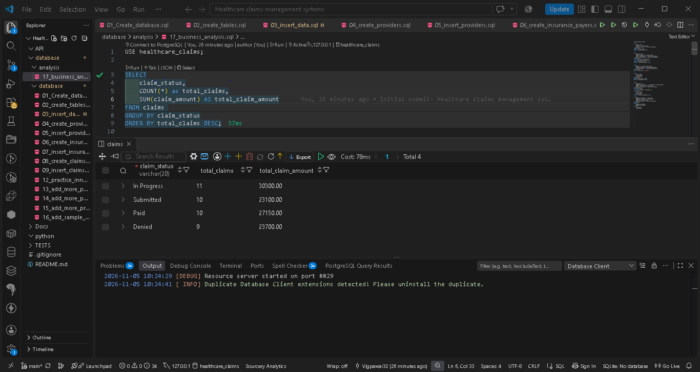
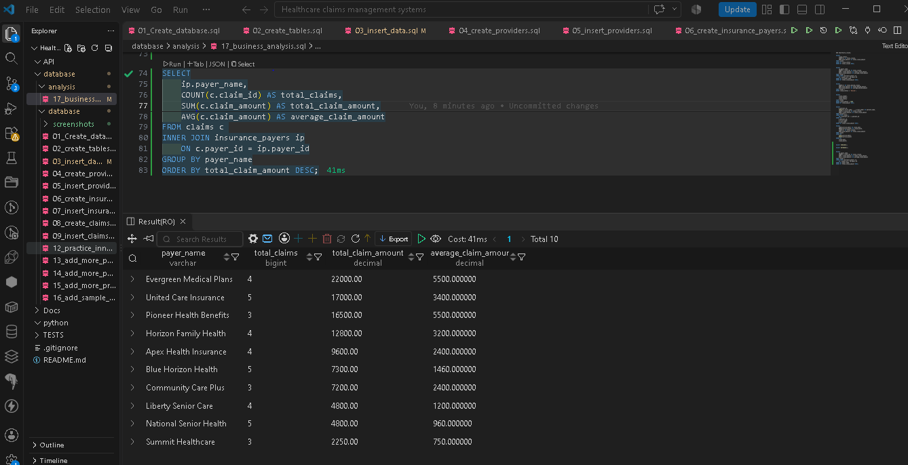
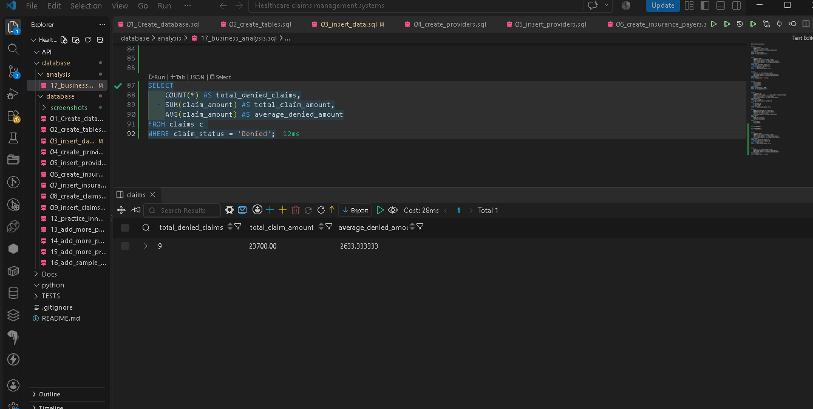
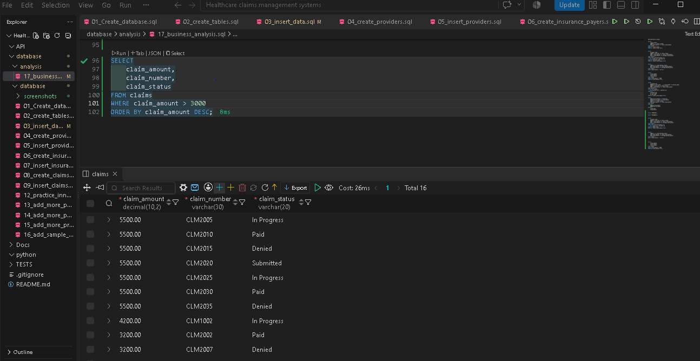
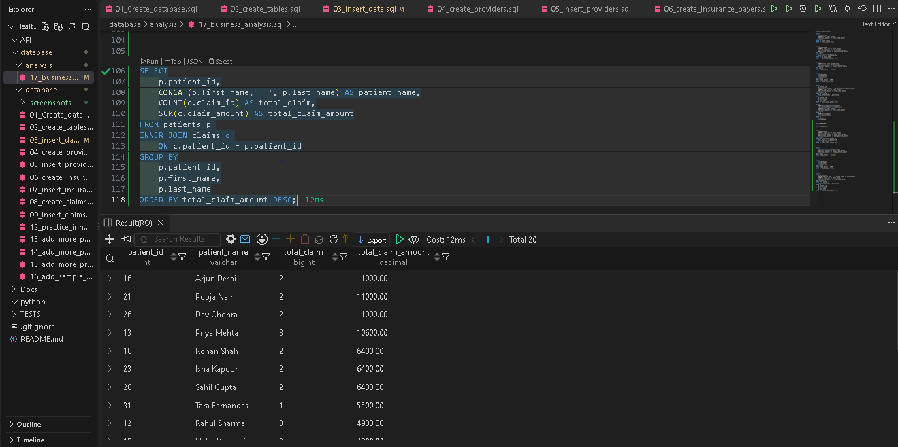
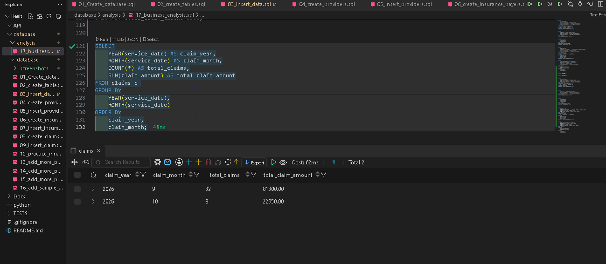

Healthcare Claims Management System

A MySQL-based relational database project designed to manage healthcare claims, patient records, healthcare providers, and insurance payers while performing business-focused SQL analysis.

1. Project Overview

Healthcare organisations process numerous medical claims through different insurance providers. Managing these claims requires organised data, accurate records, and efficient reporting.

This project demonstrates how a relational database can organise healthcare claims information and generate meaningful business insights using SQL.

2. Business Objectives

Maintain structured patient information.

Manage healthcare provider records.

Store insurance payer information.

Track medical claims and their statuses.

Analyse claim amounts and denial patterns.

Generate reports to support business decisions.

3. Technologies Used

MySQL 8.0.36

SQL

Visual Studio Code

Git

GitHub

4. Database Architecture

The database consists of four interconnected tables:

Table

Description

Patients

Stores patient information

Providers

Stores healthcare provider details

Insurance Payers

Stores insurance company information

Claims

Stores claim numbers, service dates, amounts and statuses

Table Relationships

One patient can have multiple claims.

One provider can be associated with multiple claims.

One insurance payer can process multiple claims.

The Claims table connects these entities using foreign keys.

5. Dataset

The project contains synthetic sample data:

Table

Records

Patients

20

Insurance Payers

10

Providers

8

Claims

40

Total

78

All records are fictional and created for educational purposes.

6. SQL Concepts Demonstrated

Database and table creation

Primary Keys and Foreign Keys

Data manipulation (INSERT, UPDATE, DELETE)

INNER JOIN and LEFT JOIN

WHERE and ORDER BY

GROUP BY and HAVING

Aggregate functions (COUNT, SUM, AVG, MIN, MAX)

CASE WHEN statements

Common Table Expressions (CTEs)

Data analysis and reporting

7. Business Analysis

The project includes six business-focused SQL analyses:

Claim Status Analysis – Analyses claim distribution by status and total claim amounts.

Insurance Payer Analysis – Evaluates claim volume and financial value by payer.

Denial Analysis – Calculates denied claim counts and amounts.

High-Value Claims – Identifies claims exceeding a specified financial threshold.

Patient Claim History – Analyses claim activity and total claim amounts per patient.

Monthly Claims Analysis – Examines monthly claim volumes and financial trends.

9. Project Structure

Healthcare-Claims-Management-System/
│
├── database/
│   ├── analysis/
│   │   └── 17_business_analysis.sql
│   │
│   └── database/
│       ├── screenshots/
│       │   ├── 01_claim_status_analysis.png
│       │   ├── 02_payer_analysis.png
│       │   ├── 03_denial_analysis.png
│       │   ├── 04_high_value_claims.png
│       │   ├── 05_patient_claim_history.png
│       │   └── 06_monthly_claims_analysis.png
│       │
│       ├── 01_Create_database.sql
│       ├── 02_create_tables.sql
│       ├── 03_insert_data.sql
│       ├── 04_create_providers.sql
│       ├── 05_insert_providers.sql
│       ├── 06_create_insurance_payers.sql
│       ├── 07_insert_insurance_payers.sql
│       ├── 08_create_claims.sql
│       ├── 09_insert_claims.sql
│       ├── 12_practice_inner_join.sql
│       ├── 13_add_more_payers.sql
│       ├── 14_add_more_patients.sql
│       ├── 15_add_more_providers.sql
│       └── 16_add_sample_claims.sql
│
├── API/
├── Docs/
├── python/
├── TESTS/
├── .gitignore
└── README.md

10. Project Purpose

This project was developed to strengthen practical SQL skills and demonstrate relational database design, data management, multi-table joins, and business analysis using a healthcare claims management scenario.

Author

Vignesh Pawar

GitHub: Vigpawar32

Project Repository: Healthcare Claims Management System